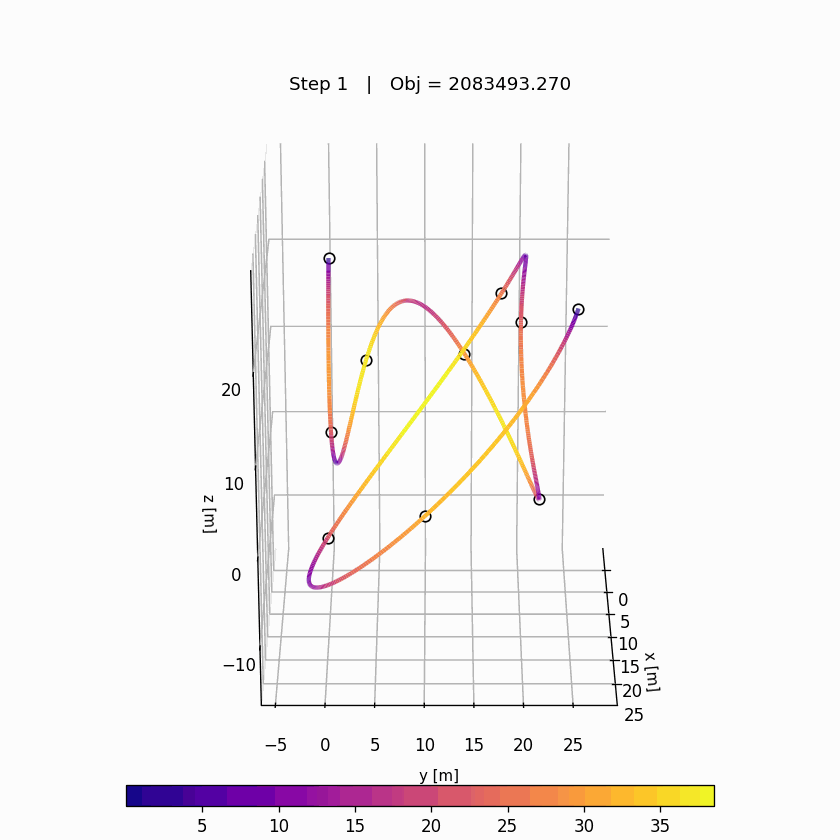

# trajectory_optimization

This project generates smooth 2D or 3D trajectories through a sequence of
waypoints. It supports fixed segment durations as well as optimization of the
time assigned to each segment. The trajectory can be optimized for velocity,
acceleration, or any higher derivative supported by the polynomial degree.

See `visualization/example_timestamps.py` and
`visualization/example_no_timestamps.py` for basic usage.

## Project Layout

- `source/` contains the trajectory solver and constraint-builder modules.
- `visualization/` contains examples, plotting scripts, convergence analyses,
  and GIF export utilities.
- `data/` contains generated CSV results.
- `img/` contains generated plots and animations.

Run visualization scripts from the repository root, for example:

```bash
python -m visualization.example_timestamps
python -m visualization.example_no_timestamps
```



## Method

The trajectory is represented independently in each spatial dimension as a
piecewise polynomial. For segment `i`, the position is

```
p_i(t) = c_0 + c_1 t + ... + c_d t^d,    0 <= t <= T_i
```

where `d` is the polynomial degree, `T_i` is the duration of the segment, and
the coefficients `c_k` are the optimization variables.

The objective minimizes the squared norm of the `r`-th derivative over all
segments:

```
J = sum_i integral_0^T_i || d^r p_i(t) / dt^r ||^2 dt
```

For fixed segment durations, this objective is quadratic in the polynomial
coefficients. The integral is assembled into a block-diagonal cost matrix, so
the coefficient problem becomes a quadratic program solved with OSQP.

The constraints enforce that:

- Every segment starts and ends at the requested waypoints.
- Position and derivatives are continuous between neighboring segments up to
	order `q`.
- The same constraints are applied independently to every spatial dimension.

The result is a smooth trajectory with a controllable tradeoff between
polynomial flexibility (`d`), the derivative being minimized (`r`), and the
continuity order (`q`).

### Second-Order Bilevel Optimization

When segment durations are not fixed, the problem is formulated as a bilevel
optimization:

1. The inner problem solves the constrained quadratic program for the
	polynomial coefficients using OSQP, for a given vector of segment durations.
2. The outer problem changes the segment durations while preserving the total
	travel time and positivity of every segment duration.

The outer objective is the optimal value of the inner problem. Its gradient and
Hessian with respect to the segment durations are obtained by differentiating
the inner KKT system, including the duration-dependent cost and continuity
constraint matrices. This gives a second-order bilevel method: the outer step
uses both the gradient and Hessian of the optimized trajectory cost rather than
finite differences of complete solves.

The implementation includes Newton, hybrid, trust-region constrained, and
backtracking line-search variants. For larger problems, the outer Hessian can
be approximated with a band around its diagonal to reduce computation.

## Solvers

The inner fixed-time quadratic program is solved with OSQP. The outer
time-optimization routines use the derivatives of the inner KKT system and
SciPy optimization interfaces where appropriate.

